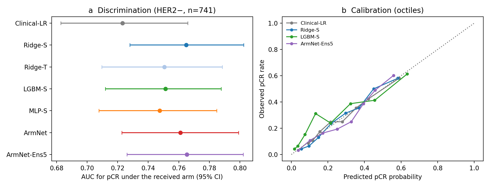
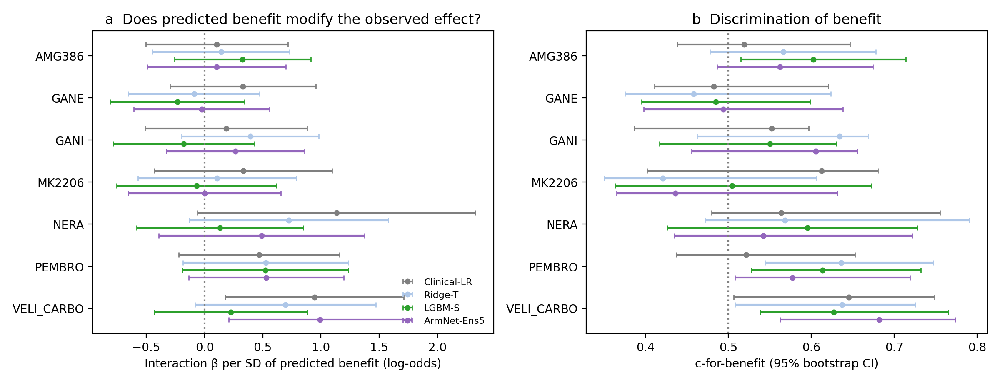

# arm-benefit-net

**Which trial arm is each patient most likely to respond to? Treatment-conditioned deep learning on public oncology clinical-trial transcriptomics, built step by step in PyTorch, with leakage-safe validation.**

📄 **Full report (Nature-style):** [`docs/report.md`](docs/report.md) · 🎓 **Course:** [`lessons/`](lessons/)

## Key findings
Data: I-SPY2 (GSE194040): 741 randomised HER2-negative breast cancer patients, 7 drug arms plus a shared control. IMvigor210: 348 patients on atezolizumab, used as an external test.

1. **Expression improves response prediction over clinical subtype:** AUC 0.765 (95% CI 0.73–0.80) vs 0.723 (0.68–0.77). A multi-task network (**ArmNet**) **ties with ridge regression** (both 0.765). Deep learning doesn't win on this tabular problem.
2. **No model identifies *which drug benefits whom* beyond subtype.** None of 49 benefit tests survives FDR correction. The strongest signal (veliparib + carboplatin) is matched by a clinical-only model.
3. **Explanations confirm it:** Integrated-Gradients attributions for pembrolizumab and PARP + platinum benefit are highly correlated (ρ = 0.62) and not enriched for immune or DNA-repair genes.
4. **External test:** the transferred "pembrolizumab benefit" score doesn't predict atezolizumab response (AUC 0.48), while the positive controls TMB (0.73) and CD8 T-effector (0.61) do.
5. **Foundation model:** frozen **BulkFormer** embeddings add nothing over mutational burden for survival (C-index 0.57 vs 0.57).

**Take-home:** at single-trial scale, transcriptomes give a well-calibrated *prognosis*, not a reliable *treatment choice*. Benefit models need pooled randomised data and external validation.

| | |
|---|---|
|  |  |

## Reproduce
```bash
conda env create -f environment.yml && conda activate armbenefit
pytest -q                                   # unit tests on synthetic data (also run in CI)
python scripts/01_download_ispy2.py         # GEO download with SHA-256 manifest
python scripts/02_eda_ispy2.py              # Table 1, Fig 1
python scripts/04_benchmark_ispy2.py        # nested CV, 3x5 folds (~20 min on a 4-core laptop CPU)
python scripts/05_evaluate_ispy2.py         # Tables 2-4, Figs 2-4
python scripts/06_final_model_explain.py    # final ArmNet ensemble + Integrated Gradients (Table 5, Fig 5)
# IMvigor210: see the headers of scripts/03_export_imvigor210.R (R env) and 08_bulkformer_embeddings.py (BulkFormer env)
python scripts/07_imvigor210.py             # Tables 6-7, Fig 6
```

## Course (`lessons/`)
| # | Lesson | PyTorch / ML concept |
|---|---|---|
| 00 | Setup | reproducible environments, seeds, tests |
| 01 | Tensors and autograd | logistic regression from scratch, checked against scikit-learn |
| 02 | Know the trial | I-SPY2 design, confounding, batch effects |
| 03 | Leakage-safe validation | nested CV, calibration, benefit metrics |
| 04 | Baselines | ridge, T/S-learners, gradient boosting, two real bugs |
| 05 | `nn.Module` and training loop | DataLoader, AdamW, dropout, early stopping |
| 06 | ArmNet | multi-task heads, factual loss, treatment-effect heterogeneity |
| 07 | Ensembles and calibration | deep ensembles, calibration slope |
| 08 | Transformers and foundation models | attention, `huggingface_hub`, BulkFormer |
| 09 | Custom losses and transfer | Cox partial likelihood, DeepCox, external validation |
| 10 | Explainability and reporting | Captum Integrated Gradients, writing negative results |

## Repository map
| Folder | Content |
|---|---|
| `src/armbenefit/` | data loaders, leakage-safe CV and metrics, models (ArmNet, baselines, DeepCox) |
| `scripts/` | numbered scripts reproducing every table and figure |
| `results/` | aggregate result tables (no patient-level data) |
| `docs/` | report, figures, references |
| `tests/` | unit and integration tests |

## How it was built
Developed with an AI coding agent (Claude Code), with every step reviewed, tested and documented by the author.

## License
Code: MIT. No patient-level data is stored in this repository; scripts download it from the original sources.

**Data attribution.** I-SPY2-990: NCBI GEO GSE194040 (Wolf et al., *Cancer Cell* 2022). IMvigor210 data: Mariathasan S et al., *Nature* 2018 (doi:10.1038/nature25501), IMvigor210CoreBiologies R package v1.0.1 (http://research-pub.gene.com/IMvigor210CoreBiologies/), licensed under CC BY 3.0 (https://creativecommons.org/licenses/by/3.0/). We did not redistribute the data; we converted counts to log2 CPM, mapped gene identifiers and derived aggregate statistics.
BulkFormer weights: https://huggingface.co/zhfanrui/BulkFormer-37M (MIT); Kang B, Fan R, Yi M, Cui C, Cui Q. BulkFormer: a large-scale foundation model for bulk transcriptomes. *Cell Systems* 2026;17:101657. doi:10.1016/j.cels.2026.101657 (preprint: bioRxiv 2025, doi:10.1101/2025.06.11.659222).
