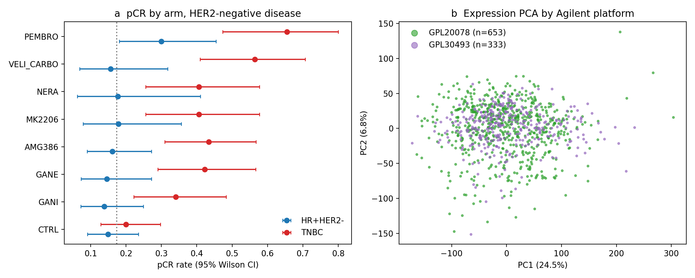
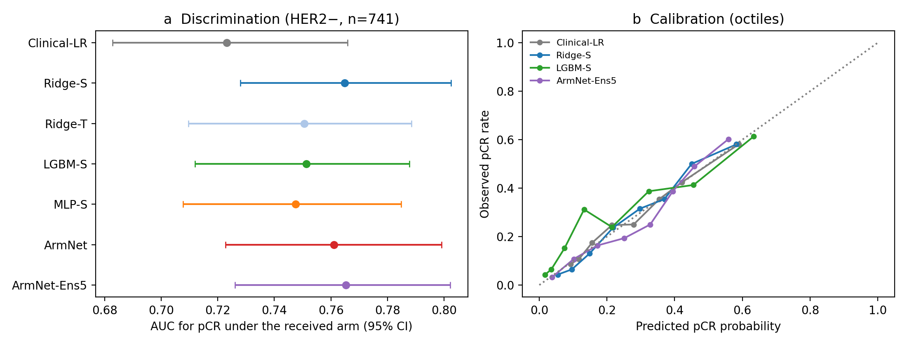
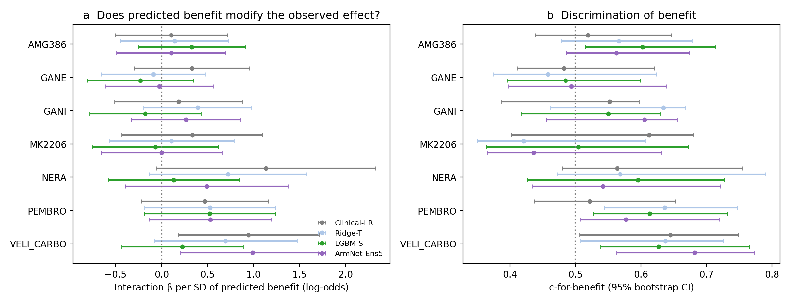
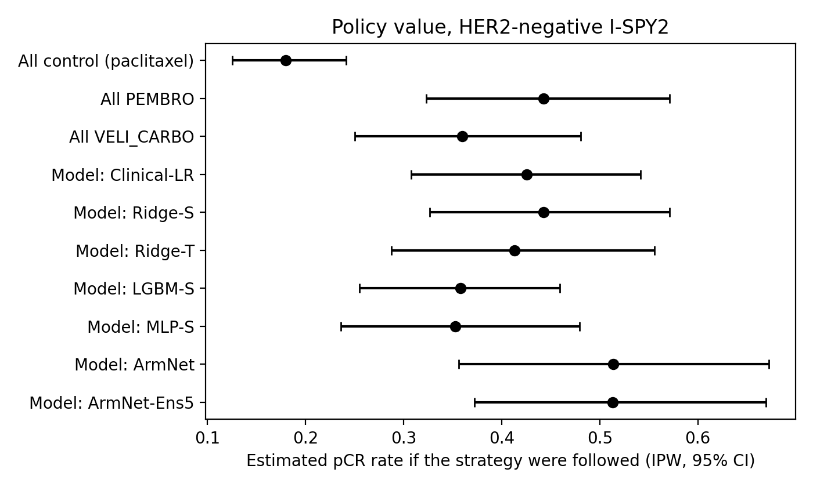
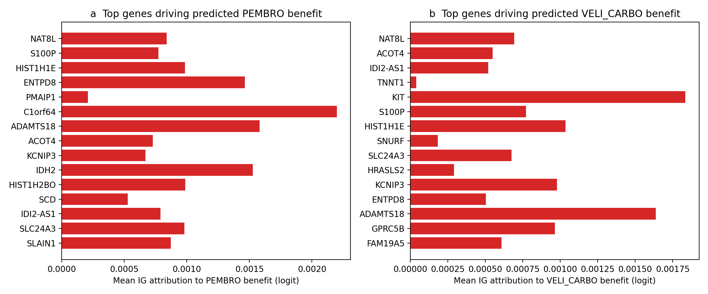
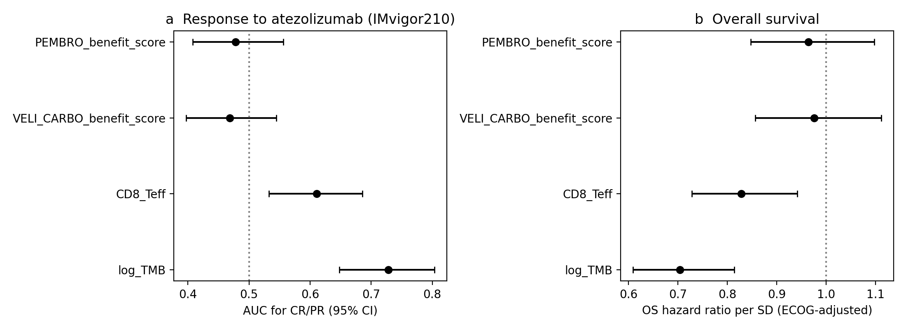

# Pre-treatment transcriptomes predict who responds but not which drug benefits whom: a leakage-safe, multi-arm deep-learning reanalysis of I-SPY2 with external testing in IMvigor210

**Felipe Morillo Sanz Dias**

*Code and full reproducibility: this repository (`arm-benefit-net`). Developed with an AI coding agent (Claude Code); every step was reviewed, tested and logged.*

---

## Abstract
Platform trials randomise patients with molecularly profiled tumours to many drugs against a shared control. In principle this lets us learn *which* drug benefits *which* patient. We asked whether a treatment-conditioned neural network, ArmNet, can estimate patient-level, arm-specific benefit from pre-treatment gene expression. ArmNet uses a shared tumour representation and one output head per arm. We studied 741 patients with HER2-negative breast cancer randomised in the I-SPY2 trial to paclitaxel alone (n = 179) or paclitaxel plus one of seven investigational agents. We compared ArmNet with clinical-only, penalised-regression, gradient-boosting and pooled neural-network models under nested, patient-level cross-validation. All preprocessing was fitted within training folds.

Expression improved discrimination of pathologic complete response (pCR) over HR status and MammaPrint: AUC 0.765 (95% CI 0.726–0.802) for the ArmNet ensemble and 0.765 (0.728–0.802) for ridge regression, against 0.723 (0.683–0.766) for the clinical model. Probabilities were well calibrated (calibration slope 1.00–1.12). However, no model's predicted benefit modified the randomised treatment effect beyond clinical subtype after correcting for 49 tests (all q ≥ 0.26). The strongest signal, for veliparib + carboplatin (interaction β = 0.99 per SD, p = 0.013), was matched by the clinical-only model (β = 0.94, p = 0.016). Integrated-gradient attributions for pembrolizumab and veliparib + carboplatin benefit were highly correlated (Spearman ρ = 0.62) and were not enriched for T-cell or DNA-repair programmes. In an external single-arm cohort (IMvigor210, atezolizumab, n = 348), the transferred pembrolizumab-benefit score did not predict response (AUC 0.48, 0.41–0.56), whereas the established positive controls did: tumour mutational burden (AUC 0.73) and CD8 T-effector expression (AUC 0.61). Embeddings from a bulk-transcriptome foundation model (BulkFormer) did not improve survival prediction over mutational burden alone.

At the scale of a single platform trial (49–179 patients per arm), transcriptomes support prognostic modelling but not reliable individual treatment selection. Patient-level benefit models need larger or pooled randomised datasets and external validation before clinical use.

---

## Introduction
Most oncology drugs help a minority of the patients who receive them, and identifying that minority before treatment is a central aim of translational science. Biomarkers that forecast outcome regardless of therapy (*prognostic*) are common. Biomarkers that forecast which therapy works better (*predictive*) are rarer and require randomised comparisons to establish¹. Platform trials such as I-SPY2 randomise patients to many agents against a shared control within molecular strata², and its pre-treatment expression resource (I-SPY2-990)³ is among the largest public datasets in which predictive questions can be asked across many drugs at once.

The original analysis of I-SPY2-990 tested predefined expression signatures and proposed response-predictive subtypes that improved treatment assignment at the subtype level³. Two questions remained open:
- whether a flexible model can learn **patient-level**, arm-specific response surfaces directly from the transcriptome;
- whether such a model's benefit estimates hold up under the validation standards now expected of clinical machine learning: patient-level and cross-study evaluation, leakage control, calibration and uncertainty⁴⁻⁶.

Deep multi-task networks with a shared representation and treatment-specific heads were developed for exactly this kind of individual-treatment-effect estimation⁷. Yet on tabular biomedical data, deep models frequently fail to beat penalised regression or tree ensembles⁸,⁹. Foundation models pretrained on hundreds of thousands of transcriptomes¹⁰ add a further, untested candidate source of predictive features.

We therefore built ArmNet, a treatment-conditioned network for multi-arm trials. We benchmarked it against strong baselines under nested cross-validation and evaluated benefit (not only response) using the trial's randomisation. We then tested transfer to an independent immunotherapy cohort (IMvigor210¹¹) and evaluated BulkFormer embeddings there.

## Results

### Cohort and design features that constrain modelling
Of 986 I-SPY2-990 patients with expression and pCR, 741 had HER2-negative disease and were randomised to the shared control (paclitaxel, n = 179) or one of seven investigational arms (n = 49–115 each; Table 1, Fig. 1a). The pCR rate was 27.8% overall, 16.9% in HR+/HER2− and 39.2% in triple-negative (TNBC) disease. Arm effects differed sharply by subtype. In TNBC, pCR was 20% (95% CI 13–30%) with control, 66% (47–80%) with pembrolizumab and 56% (41–71%) with veliparib + carboplatin. In HR+/HER2− disease, only pembrolizumab exceeded control (30% vs 15%).

Two features of the public resource mattered for interpretation:
- **Platform confounding.** Expression came from two Agilent platforms that the data authors had harmonised. Residual platform signal was small: the top ten principal components predicted platform with AUC 0.54 ± 0.04 (Fig. 1b). But platform was completely confounded with arm for four arms (neratinib and veliparib + carboplatin only on GPL30493; pembrolizumab and ganetespib only on GPL20078).
- **Missing arm.** The durvalumab + olaparib arm⁽¹²⁾ is not part of this resource.

### Expression improves response prediction, but deep learning does not beat ridge regression
Under 3 × 5-fold nested cross-validation, expression-based models discriminated pCR under the received arm better than the clinical model (HR, MammaPrint, platform, arm and arm × subtype interactions; AUC 0.723, 0.683–0.766). See Table 2 and Fig. 2a.
- The ArmNet deep ensemble (AUC 0.765, 0.726–0.802) and ridge logistic regression (S-learner; 0.765, 0.728–0.802) performed identically.
- A single ArmNet reached 0.761; the pooled MLP 0.747; gradient boosting 0.751; per-arm ridge 0.751.
- Variation across CV repeats was small (SD ≤ 0.011).
- ArmNet and the clinical model were well calibrated (slopes 1.006 and 1.004; Fig. 2b). The ensemble was slightly under-confident (slope 1.12). Gradient boosting was over-confident (slope 0.69).

### No robust evidence that expression identifies which arm benefits whom
For each investigational arm we tested whether out-of-fold predicted benefit (predicted pCR under the arm minus under control) modified the randomised treatment effect, adjusting for randomisation strata (Table 3, Fig. 3a).
- **Veliparib + carboplatin** showed the clearest effect modification: ArmNet ensemble β = 0.99 log-odds per SD (0.21–1.78; p = 0.013). The clinical model achieved almost the same (β = 0.94; p = 0.016), which shows the signal is largely captured by subtype.
- **Pembrolizumab:** genomic models discriminated benefit modestly better than the clinical model (c-for-benefit 0.58–0.64 vs 0.52; Fig. 3b), but none of the interaction tests reached significance (p ≥ 0.07).
- **Beyond clinical predicted benefit:** no genomic model added significant effect modification (Table 3b). The best was ArmNet for veliparib + carboplatin, β = 0.74 (−0.14 to 1.62; p = 0.098).
- **Multiple testing:** after Benjamini–Hochberg correction across 49 tests, no result had q < 0.25.

Assigning each patient the arm with the highest predicted pCR gave an estimated pCR rate (inverse-probability weighted) of 51% (37–67%) for ArmNet. This compares with 18% (13–24%) for control-for-all, 44% (32–57%) for pembrolizumab-for-all and 43% (31–54%) for the clinical model (Table 4, Fig. 4). ArmNet recommended pembrolizumab to about 61% of patients. The confidence intervals overlap widely, and each estimate rests on only 44–71 patients whose randomised arm matched the recommendation.

### Attributions point to shared, not drug-specific, biology
Integrated Gradients⁽¹³⁾ applied to the final ensemble (completeness error ≤ 3.6 × 10⁻³) attributed predicted benefit for pembrolizumab and for veliparib + carboplatin to largely the same genes.
- The signed attributions correlated across genes (Spearman ρ = 0.62), and 14 of the top 25 genes were shared (e.g. *NAT8L*, *S100P*, *HIST1H1E*, *ENTPD8*; Table 5, Fig. 5).
- Neither the CD8 T-effector, immune-checkpoint and antigen-presentation programmes (pembrolizumab; permutation p = 0.51–0.74) nor DNA-repair and proliferation programmes (veliparib + carboplatin; p = 0.28–0.70) were enriched among high-attribution genes.

### External test in IMvigor210
We froze the pembrolizumab-benefit attributions into a linear score and applied it unchanged to 348 patients with metastatic urothelial carcinoma treated with atezolizumab¹¹ (1,486 of 2,000 genes shared; Table 6, Fig. 6).
- The score did not predict objective response (AUC 0.48, 0.41–0.56) or survival (HR 0.96 per SD, 0.85–1.10).
- The negative-control veliparib + carboplatin score behaved the same (AUC 0.47).
- The positive controls reproduced the original study: tumour mutational burden (AUC 0.73, 0.65–0.80; HR 0.70 per SD) and CD8 T-effector expression (AUC 0.61, 0.53–0.69; HR 0.83, p = 0.004). This confirms that the pipeline itself is sound.

In 5-fold × 3 cross-validated survival prediction (Table 7):
- the best model was ridge Cox on principal components of expression plus mutational burden (C-index 0.591 ± 0.032);
- frozen BulkFormer embeddings (131 dimensions from a 37M-parameter model; 4.3% of its vocabulary missing) with mutational burden reached 0.571, no better than mutational burden alone (0.567);
- PyTorch linear and deep Cox models trained on the full gene set reached 0.51–0.55.

## Discussion
In the largest public multi-arm neoadjuvant expression resource, a purpose-built, treatment-conditioned network matched but did not exceed ridge regression for response prediction. Under randomisation-based evaluation, neither it nor any baseline identified which patients benefit from which drug beyond what clinical subtype already conveys. The model's explanations and its failure to transfer to an independent immunotherapy cohort agree: the arm-specific heads mostly re-encode a shared prognostic axis rather than drug-specific biology.

These findings sharpen, rather than contradict, the original I-SPY2-990 analysis³.
- Subtype-level assignment informed by expression (as in response-predictive subtypes) is supported by the strong subtype × arm interactions we also observe.
- Patient-level refinement within subtypes is not supported at this sample size.
- This matches the statistical expectation: detecting a treatment–covariate interaction of the same size as the main effect needs about four times the sample size¹⁷, and benefit models are especially prone to optimism without external validation¹⁴,¹⁵.
- Our upper bound on benefit discrimination (c-for-benefit ≈ 0.6) is consistent with reports from other randomised settings¹⁵.

Three findings are practical lessons for translational machine learning:
1. **Discrimination of response is not evidence of predictive value.** Several models had AUCs above 0.75 while carrying no benefit information beyond subtype. A response AUC should never be presented as support for treatment selection¹.
2. **Design-level artefacts must be confronted explicitly.** Platform was confounded with arm, adaptive randomisation varied over calendar time, and penalised models silently shrank treatment indicators to zero. We found and corrected that last failure only because counterfactual predictions were checked.
3. **Foundation-model embeddings are not automatically informative.** Frozen BulkFormer embeddings, applied as its developers specify, did not beat a single clinical covariate for survival. That reflects small cohorts, mean-pooling over 20,000 genes and a self-supervised objective unrelated to the endpoint. We also chose *not* to apply BulkFormer to microarray data, where its count-based preprocessing would be invalid.

**Limitations.**
- Arms of 49–115 patients limit power for interaction effects.
- Propensities for policy evaluation condition on HR × MammaPrint strata but not calendar time, so policy values are approximate.
- Expression harmonisation by the data providers used all samples.
- IMvigor210 is single-arm. It tests prognosis under immunotherapy across cancer type, platform and drug, not benefit over a comparator, and is therefore a demanding test of transfer.
- We did not fine-tune foundation models, and larger RNA-seq trial cohorts may reverse that conclusion.
- Hyperparameter grids were deliberately small for CPU feasibility.

**Future work.** Pooling individual-patient data across randomised trials of the same drug class (e.g. PD-(L)1 or PARP inhibitors) is the most direct route to adequately powered benefit models. The durvalumab + olaparib I-SPY2 arm¹² is a natural next test set for the PARP and checkpoint signals examined here.

## Conclusion
Pre-treatment transcriptomes modestly improve prediction of pathologic complete response beyond clinical subtype. In 741 randomised patients across seven drugs, they did not support patient-level selection of the drug most likely to help: not with deep multi-task networks, not with explanation methods, and not on transfer to an external cohort. Treatment-conditioned deep learning is a sound framework for this question, but its benefit estimates must be validated against randomised contrasts and external data. At current single-trial sample sizes, its honest output is a well-calibrated prognosis, not a treatment recommendation.

---

## Methods

**Data.**
- *I-SPY2-990:* gene-level Agilent expression and annotations (HR, HER2, MammaPrint, arm, pCR) from GEO GSE194040, downloaded with SHA-256 checksums. Genes with any missing value were removed (17,993 complete genes in the full cohort; 18,198 within the HER2-negative subset). The analysis cohort was HER2-negative patients in the control arm and the seven investigational arms sharing it.
- *IMvigor210:* the IMvigor210CoreBiologies R package (v1.0.1)¹¹, exported in plain R. Raw counts were converted to log₂(CPM + 1). Genes with mean CPM < 1 were removed.

**Models.** All models output P(pCR | x, arm) for every arm, with a common interface.
- *Clinical-LR:* logistic regression on HR, MammaPrint, platform, arm and arm × (HR, MammaPrint).
- *Ridge-S:* ridge logistic regression on genes, clinical covariates and arm. Design columns were rescaled ×30 so they were effectively unpenalised.
- *Ridge-T:* one ridge model per arm.
- *LGBM-S:* gradient boosting with arm as a feature.
- *MLP-S:* a pooled multilayer perceptron with arm as an input.
- *ArmNet:* a shared trunk (input dropout 0.2; 64 → 32 units, ReLU, dropout) with one linear head per arm. It was trained with a factual binary cross-entropy loss (each patient contributes only through the head of the arm received), AdamW, mini-batches of 64 and early stopping on a 20% validation split⁷.
- *ArmNet-Ens5:* the average of five independently seeded ArmNets¹⁶.

**Validation.**
- Outer 5-fold cross-validation stratified by arm × subtype × pCR, repeated three times. Out-of-fold predictions were averaged over repeats.
- Within each training fold: the 2,000 most variable genes were selected and z-scored (no labels used); ridge penalties were tuned by internal 3-fold CV; network dropout {0.3, 0.6} and weight decay {10⁻³, 10⁻²} were tuned by inner 3-fold CV on factual log-loss⁴,⁵.

**Metrics.**
- AUC with patient-bootstrap 95% CIs (1,000 resamples); Brier score; calibration intercept and slope⁶.
- *Benefit:* a logistic model, among patients in arm *a* or control, with treatment, standardised predicted benefit, their interaction and randomisation strata (HR × MammaPrint). We also report a model adding the clinical model's predicted benefit and its interaction ("beyond clinical"), c-for-benefit with stratum-matched pairs¹⁵, and Benjamini–Hochberg false discovery rates.
- *Policy value:* Hájek inverse-probability-weighted estimate with empirical P(arm | stratum).

**Explainability.** Integrated Gradients¹³ (Captum, 64 steps, all-zero baseline = the average training patient) on the ensemble-mean benefit logit (head *a* minus control head). Gene-set enrichment of mean |attribution| was tested against 10,000 random gene sets of equal size, using the signatures distributed with IMvigor210CoreBiologies¹¹. Hypotheses were fixed before inspection.

**External transfer and survival.**
- The pembrolizumab and veliparib + carboplatin benefit scores were defined as Σ_g w_g z_g, with *w* the mean signed attributions from I-SPY2 and *z* expression z-scored within IMvigor210. Nothing was fitted on IMvigor210.
- Association with response used AUC (2,000 bootstraps) and with overall survival an ECOG-adjusted Cox model. Added value over CD8 T-effector and log-TMB used a likelihood-ratio test.
- Survival prediction used 5-fold × 3 CV stratified by event, scored by Harrell's C-index. Models: ridge Cox on 50 fold-fitted principal components; PyTorch linear and deep Cox models with a vectorised partial-likelihood loss (verified against lifelines); and BulkFormer-37M¹⁰ sample embeddings (log1p-TPM input, Entrez → Ensembl mapping by HGNC, mean pooling, frozen).

**Software and reproducibility.** Python 3.11, PyTorch 2.5.1 (CPU), scikit-learn 1.5.2, LightGBM 4.5.0, lifelines 0.29.0, Captum 0.7.0. BulkFormer ran in a separate environment (PyTorch 2.6, transformers 5.23). Unit and integration tests (synthetic data) run in continuous integration. All analyses run on a 4-core laptop CPU.

**Data and code availability.** All data are public. I-SPY2-990: GEO GSE194040 (Wolf et al. 2022). IMvigor210 data: Mariathasan S et al., *Nature* 2018 (doi:10.1038/nature25501), IMvigor210CoreBiologies R package v1.0.1 (http://research-pub.gene.com/IMvigor210CoreBiologies/), licensed under CC BY 3.0 (https://creativecommons.org/licenses/by/3.0/). We did not redistribute the data; we converted counts to log2 CPM, mapped gene identifiers and derived aggregate statistics. Scripts `01`–`08` reproduce every table and figure. No patient-level data are redistributed.

---

## Tables and figures
| Item | File |
|---|---|
| Table 1: cohort by arm and subtype | `results/table1_cohort.csv` |
| Table 2: response prediction | `results/table2_prediction.csv` |
| Table 3 / 3b: benefit; benefit beyond clinical | `results/table3_benefit.csv`, `results/table3b_benefit_beyond_clinical.csv` |
| Table 4: policy value | `results/table4_policy.csv` |
| Table 5 / 5b: top attributed genes; gene-set tests | `results/table5_ig_top_genes.csv`, `results/table5b_geneset_tests.csv` |
| Table 6 / 6b: IMvigor210 transfer; added value | `results/table6_imvigor_transfer.csv`, `results/table6b_imvigor_added_value.csv` |
| Table 7: IMvigor210 survival CV | `results/table7_imvigor_survival_cv.csv` |
| Fig. 1: cohort; platform PCA | `docs/figures/fig1_cohort.png` |
| Fig. 2: discrimination; calibration | `docs/figures/fig2_prediction.png` |
| Fig. 3: benefit modification; c-for-benefit | `docs/figures/fig3_benefit.png` |
| Fig. 4: policy value | `docs/figures/fig4_policy.png` |
| Fig. 5: Integrated Gradients | `docs/figures/fig5_explainability.png` |
| Fig. 6: IMvigor210 transfer | `docs/figures/fig6_imvigor_transfer.png` |

## References
1. Ballman KV. Biomarker: predictive or prognostic? *J Clin Oncol* 2015;33:3968–3971. doi:10.1200/JCO.2015.63.3651
2. Barker AD et al. I-SPY 2: an adaptive breast cancer trial design in the setting of neoadjuvant chemotherapy. *Clin Pharmacol Ther* 2009;86:97–100. doi:10.1038/clpt.2009.68
3. Wolf DM et al. Redefining breast cancer subtypes to guide treatment prioritization and maximize response: predictive biomarkers across 10 cancer therapies. *Cancer Cell* 2022;40:609–623. doi:10.1016/j.ccell.2022.05.005
4. Varma S, Simon R. Bias in error estimation when using cross-validation for model selection. *BMC Bioinformatics* 2006;7:91. doi:10.1186/1471-2105-7-91
5. Kapoor S, Narayanan A. Leakage and the reproducibility crisis in machine-learning-based science. *Patterns* 2023;4:100804. doi:10.1016/j.patter.2023.100804
6. Collins GS et al. TRIPOD+AI statement. *BMJ* 2024;385:e078378. doi:10.1136/bmj-2023-078378
7. Shalit U, Johansson FD, Sontag D. Estimating individual treatment effect: generalization bounds and algorithms. ICML 2017. arXiv:1606.03976
8. Grinsztajn L, Oyallon E, Varoquaux G. Why do tree-based models still outperform deep learning on typical tabular data? NeurIPS 2022. arXiv:2207.08815
9. Christodoulou E et al. A systematic review shows no performance benefit of machine learning over logistic regression for clinical prediction models. *J Clin Epidemiol* 2019;110:12–22. doi:10.1016/j.jclinepi.2019.02.004
10. Kang B, Fan R, Yi M, Cui C, Cui Q. BulkFormer: a large-scale foundation model for bulk transcriptomes. *Cell Systems* 2026;17:101657. doi:10.1016/j.cels.2026.101657 (preprint: bioRxiv 2025, doi:10.1101/2025.06.11.659222)
11. Mariathasan S et al. TGFβ attenuates tumour response to PD-L1 blockade by contributing to exclusion of T cells. *Nature* 2018;554:544–548. doi:10.1038/nature25501
12. Pusztai L et al. Durvalumab with olaparib and paclitaxel for high-risk HER2-negative stage II/III breast cancer: results from the adaptively randomized I-SPY2 trial. *Cancer Cell* 2021;39:989–998. doi:10.1016/j.ccell.2021.05.009
13. Sundararajan M, Taly A, Yan Q. Axiomatic attribution for deep networks. ICML 2017. arXiv:1703.01365
14. Kent DM et al. The Predictive Approaches to Treatment effect Heterogeneity (PATH) statement. *Ann Intern Med* 2020;172:35–45. doi:10.7326/M18-3667
15. van Klaveren D et al. The proposed "concordance-statistic for benefit" provided a useful metric when modeling heterogeneous treatment effects. *J Clin Epidemiol* 2018;94:59–68. doi:10.1016/j.jclinepi.2017.10.021
16. Lakshminarayanan B, Pritzel A, Blundell C. Simple and scalable predictive uncertainty estimation using deep ensembles. NeurIPS 2017. arXiv:1612.01474
17. Brookes ST et al. Subgroup analyses in randomized trials: risks of subgroup-specific analyses; power and sample size for the interaction test. *J Clin Epidemiol* 2004;57:229–236. doi:10.1016/j.jclinepi.2003.08.009
